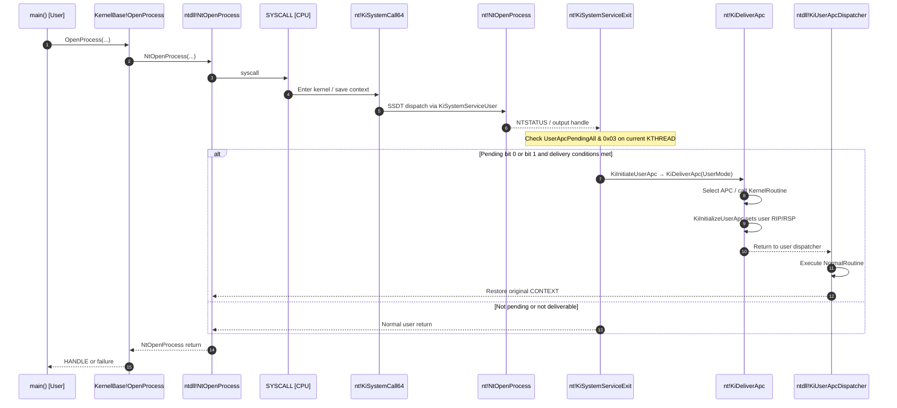
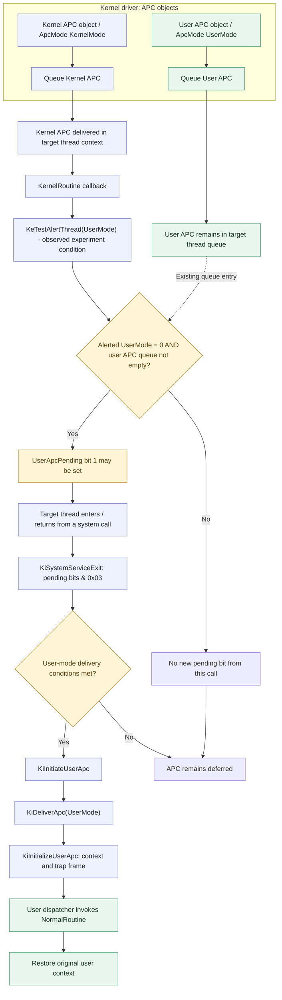

<div align="center">

# Windows Kernel APC — Non-Alertable User Callback Research

**Windows 11 25H2 (x64) · Kernel APC / User APC · SYSCALL Return Path · Reverse Engineering PoC**


**[Repository](https://github.com/lastime1650/Windows_Kernel_APC_Routine_for_User_Function_Call_on_No_Alertable_in_Driver)** · [APC internals](#apc-역공학-함수별-대조) · [실험 결과](#실험-결과와-검증-범위) · [참고 문헌](#참고-문헌)

</div>

> [!IMPORTANT]
> **이 저장소는 연구 기록입니다.** 작성자가 통제하는 테스트 프로세스와 Windows 11 25H2 x64에서 관찰한 일반 User APC의 *명시적 alertable wait 없는 전달*을 분석합니다. 공식 **Special User APC**를 생성했다는 주장은 아닙니다. `KeInitializeApc`, `KeInsertQueueApc`, `KeTestAlertThread` 및 Windows 내부 구조에 대한 설명은 대상 빌드의 IDA Pro 분석과 실험 관찰을 구분하여 기술합니다.

> [!WARNING]
> 커널 메모리, 스레드 실행 컨텍스트, 비문서화된 인터페이스를 다룹니다. 재현 가능한 결과와 운영 환경의 안정성은 별개입니다. 허가된 실험 환경에서만 사용하세요. **본문의 역공학 C 코드는 설명을 위한 의사코드이며 Microsoft 원본 소스나 컴파일 가능한 드라이버 코드가 아닙니다.**

> [!CAUTION]
> UserMode APC 등록하여 사용할때에, **특정 유저 프로세스의 함수와 인자개수에 따라 호출(최대3개의 인자 인젝션 가능) 이 가능하므로, 유저함수 호출 인젝션이 가능합니다.**


## 목차

- [프로젝트 개요와 연구 목표](#프로젝트-개요와-연구-목표)
- [APC를 처음 접하는 사람을 위한 설명](#apc를-처음-접하는-사람을-위한-설명)
- [일반 User APC와 Special User APC의 차이](#일반-user-apc와-special-user-apc의-차이)
- [커널 구조체와 오프셋](#커널-구조체와-오프셋)
- [인터랙티브 실행 흐름도 ① SYSCALL](#인터랙티브-실행-흐름도--syscall)
- [인터랙티브 실행 흐름도 ② PoC의 두 APC](#인터랙티브-실행-흐름도--poc의-두-apc)
- [APC 역공학: 함수별 대조](#apc-역공학-함수별-대조)
- [실험 결과와 검증 범위](#실험-결과와-검증-범위)
- [PoC 커널 및 유저모드 코드 해설](#poc-커널-및-유저모드-코드-해설)
- [자원 관리와 안정성 검토](#자원-관리와-안정성-검토)
- [결론과 한계](#결론과-한계)
- [참고 문헌](#참고-문헌)

---

## 프로젝트 개요와 연구 목표

### 한 문장으로 설명

**“사용자 애플리케이션이 alertable wait를 명시적으로 호출하지 않는 상황에서, Windows 커널은 어떤 조건으로 대기 중인 User APC를 유저모드 복귀 시 전달하는가?”**를 실제 커널 코드와 동적 실험으로 조사한 PoC입니다.

이 연구는 APC를 단순한 API 호출이 아닌 **(1) 대상 스레드의 APC 큐, (2) Pending 상태, (3) 커널의 전달 조건, (4) 유저모드 복귀 프레임**의 조합으로 해석합니다.

**연구 목표**

1. `_KAPC`, `_KAPC_STATE`, `_KTHREAD` 사이의 관계를 실제 오프셋 및 IDA 의사코드로 설명합니다.
2. `KeInitializeApc` → `KeInsertQueueApc` → `KiInsertQueueApc` / `KiSignalThreadForApc`의 구분을 조사합니다.
3. 커널에서 동작하는 콜백과 유저모드에서 동작하는 콜백의 역할을 분리합니다.
4. `KeTestAlertThread(UserMode)`와 일반 `UserApcPending` 비트의 관계를 검증합니다.
5. `OpenProcess()` 같은 평범한 Win32 API의 **시스템 호출 복귀 시점**에 APC 전달 검사가 이루어지는 이유를 설명합니다.
6. 성공/실패 대조 실험을 기록하되, **지원되는 공개 API 계약과 비문서화된 내부 동작을 혼동하지 않습니다.**

| 항목 | 내용 |
|---|---|
| 관찰 환경 | Windows 11 **25H2 x64** (사용자 실험 결과; 세부 빌드 리비전 미기록) |
| 분석 대상 | `ntoskrnl.exe`, x64 SYSCALL, APC 내부 디스패치 |
| 도구 | IDA Pro, WinDbg, WDK/MSVC, Win32 테스트 프로그램 |
| PoC 시나리오 | 스레드가 `OpenProcess()`/`CloseHandle()`을 반복하며 명시적 alertable wait를 호출하지 않음 |
| 관찰 결과 | 지정된 스레드 ID에서 `[APC EXECUTED]` 로그 확인 |
| 주의 | 실행까지 걸린 시간, 모든 OS 빌드 재현성, 모든 APC 비활성화 조건은 검증하지 않음 |

---

## APC를 처음 접하는 사람을 위한 설명

### 비유: 스레드는 직원, APC는 예약 작업

**스레드(Thread)**는 원래 자기 일을 계속 처리하는 직원이라고 생각할 수 있습니다. **APC(Asynchronous Procedure Call)**는 운영체제가 특정 직원에게 “가능한 조건이 되면 이 함수를 실행하라”고 예약해 둔 작업입니다.

- **`KeInitializeApc`**: 예약표를 작성합니다. *아직 예약 실행이 시작된 것은 아닙니다.*
- **`KeInsertQueueApc`**: 예약표를 해당 스레드의 대기 목록에 넣습니다.
- **`KernelRoutine`**: APC가 전달되는 과정에서 커널이 호출하는 커널 콜백입니다.
- **`NormalRoutine`**: 정상 전달 조건이 만족되면 실행할 본래의 후속 함수입니다. User APC라면 유저모드 함수 주소입니다.
- **`ApcMode`**: `NormalRoutine`을 어느 모드에서 실행할지 지정합니다. **Alertable 여부를 설정하는 값이 아닙니다.**
- **`ApcState`**: 현재 스레드에 어떤 종류의 APC가 대기하고 있는지 관리하는 상태입니다.

> [!NOTE]
> **등록(queued) ≠ 전달(delivered) ≠ 콜백 완료(completed).** `KeInsertQueueApc`가 `TRUE`를 반환해도 User APC의 실행 완료를 의미하지 않습니다.

### 가장 헷갈리는 네 가지 APC

| APC 종류 | 실행 위치 | `NormalRoutine` | Alertable wait 요구 | 일반적인 용도 |
|---|---|---|---|---|
| **Normal Kernel APC** | 커널, `PASSIVE_LEVEL` | 커널 함수 | 불필요 | 일부 파일 시스템 처리 |
| **Special Kernel APC** | 커널, `APC_LEVEL` | `NULL` | 불필요 | I/O 완료 등 |
| **Regular User APC** | 유저모드 | 유저 함수 | 공식 일반 동작에서는 필요 | `QueueUserAPC`, 비동기 I/O |
| **Special User APC** | 유저모드 | 유저 함수 | 불필요 | 별도의 특수 전달 경로 |

자료: [Microsoft — Types of APCs](https://learn.microsoft.com/en-us/windows-hardware/drivers/kernel/types-of-apcs), [Waits and APCs](https://learn.microsoft.com/en-us/windows-hardware/drivers/kernel/waits-and-apcs).

### KernelRoutine과 NormalRoutine은 같은 것이 아니다

```text
KAPC
 ├─ Thread             : 이 APC가 속한 스레드
 ├─ ApcMode            : NormalRoutine 실행 모드
 ├─ KernelRoutine      : 커널 측 전달 콜백
 ├─ RundownRoutine     : 미전달/폐기 경로의 정리 콜백
 ├─ NormalRoutine      : 실제 후속 작업(유저 APC라면 유저 함수)
 └─ NormalContext      : 후속 작업에 넘길 데이터
```

**주의할 오해:** `ApcMode = KernelMode`로 바꾸면 유저 함수가 alertable 없이 실행되는 것이 아닙니다. 유저모드 주소를 커널 `NormalRoutine`으로 취급하는 잘못된 구성은 시스템 크래시로 이어질 수 있습니다.

---

## 일반 User APC와 Special User APC의 차이

이번 연구에서 특히 중요했던 것은 이름이 비슷한 두 가지를 **분리**하는 일이었습니다.

| 주제 | Windows 공식 Special User APC | 이 PoC에서 관찰한 일반 User APC |
|---|---|---|
| 종류 | 운영체제의 Special User APC | 일반 User APC |
| 내부 분류 | 전용 `KeSpecialUserApcKernelRoutine` 포인터 비교 확인 | 일반 User APC Pending 상태 활용 |
| 대기 상태 | `SpecialUserApcPending` (bit 0) | `UserApcPending` (bit 1) |
| 지원 계약 | 공개 유저모드 API `QueueUserAPC2`가 제공 | 설명된 커널 내부 동작은 공식 드라이버 사용 계약이 아님 |
| 최초 커널 단계 | OS 내부 2단계 재등록 로직 확인 | 별도 Kernel APC가 관찰 실험에 사용됨 |
| 얻은 결과 | 내부 구조를 역공학으로 분석 | 명시적 alertable wait 없는 테스트 프로그램에서 콜백 관찰 |

`QueueUserAPC2`의 공식 문서에 따르면 Special User APC는 스레드가 시스템 호출이나 non-alertable wait에 있는 경우 그 작업이 끝난 후 전달되며, **기다리는 작업 자체를 강제로 중단하지 않습니다**. 이 PoC에서 사용한 일반 User APC의 실험 결과를 그 공식 보장과 동일시해서는 안 됩니다.

- [Microsoft — QueueUserAPC2](https://learn.microsoft.com/en-us/windows/win32/api/processthreadsapi/nf-processthreadsapi-queueuserapc2)
- [0xrepnz — User APC Internals](https://repnz.github.io/posts/apc/kernel-user-apc-api/)

---

## 커널 구조체와 오프셋

> 기준: 사용자 제공 **Windows 11 25H2 x64 `ntoskrnl.exe` IDA 분석**. 구조체 오프셋은 빌드마다 달라질 수 있습니다. 연구 편의상 함수 포인터를 원래 IDA의 `union` 자리에 펼쳐 적었습니다.

### `_KAPC` — 크기 `0x58` (88 bytes)

```c
typedef struct _KAPC_RE_VIEW {
    UCHAR Type;                       // +0x00
    UCHAR AllFlags;                   // +0x01
    UCHAR Size;                       // +0x02
    UCHAR SpareByte1;                 // +0x03
    ULONG SpareLong0;                 // +0x04
    void *Thread;                     // +0x08
    LIST_ENTRY ApcListEntry;          // +0x10
    void *KernelRoutine;              // +0x20
    void *RundownRoutine;             // +0x28
    void *NormalRoutine;              // +0x30
    void *NormalContext;              // +0x38
    void *SystemArgument1;            // +0x40
    void *SystemArgument2;            // +0x48
    signed char ApcStateIndex;        // +0x50
    signed char ApcMode;              // +0x51
    UCHAR Inserted;                   // +0x52
    UCHAR TailPadding[5];             // +0x53 (표현용 padding)
} KAPC_RE_VIEW;
```

### `_KAPC_STATE` — Pending 상태

```c
typedef struct _KAPC_STATE_RE_VIEW {
    LIST_ENTRY ApcListHead[2];       // +0x00
    void *Process;                   // +0x20
    union {                          // +0x28
        UCHAR InProgressFlags;
        struct {
            UCHAR KernelApcInProgress  : 1;
            UCHAR SpecialApcInProgress : 1;
            UCHAR Reserved             : 6;
        };
    };
    UCHAR KernelApcPending;          // +0x29
    union {                          // +0x2A
        UCHAR UserApcPendingAll;
        struct {
            UCHAR SpecialUserApcPending : 1; // 0x01
            UCHAR UserApcPending        : 1; // 0x02
            UCHAR Reserved              : 6;
        };
    };
} KAPC_STATE_RE_VIEW;
```

**확인한 필드 대응:** 이 빌드의 `KTHREAD.ApcState.UserApcPendingAll`은 `_KTHREAD + 0xC2`로 접근됩니다. 그래서 `KiSystemServiceExit`의 `test byte ptr [rcx+0C2h], 3`은 두 사용자 APC Pending 비트의 OR 조건을 검사합니다.

---

## 인터랙티브 실행 흐름도 ① SYSCALL

**주제:** `main()` → `OpenProcess()` → `NtOpenProcess` 시스템 서비스 → `KiSystemServiceExit` → APC 확인 → 유저모드 복귀.

GitHub README에는 보안상 JavaScript 기반 드래그 UI를 직접 삽입할 수 없습니다. 대신 **GitHub 내 Mermaid 흐름도**, 접기/펼치기 가능한 설명과, **[Mermaid Live에서 확대·이동·편집하는 인터랙티브 보기](https://mermaid.live/edit#pako:eNqFVMtu2zAQ_JW1DkUCNE7aFD3oEEC1DSRI4giWjLZIe2CoTUyEIlWSMuwGufYD-on9ki5FyW-0vFgkZ_Yxs_RLxHWBURxZ_FGj4jgU7Mmw8psCWqx2WtXlA5qwr5hxgouKKQe3TChgFkr6PTqG-6lF830f9lmo8_ced41GofzELPbuKlSp0Ryt3SeMXSGlJyj_0Ru7f6IH6dRjs6_ZILm5gXvaHygi5A5Be9ciW1qH5YBJ-fHDoQJ8xhb8n_SjhXA7YTM0c8HR3-zjk3Swgg9RijmapOL7uKGwFXN8ttbhWniBCdxddZ54H04uLhqdY9io9qjf7x8HTHNJoEbbGLaa2oA11wQjEWOwS8tJoXBDJ3QeZIxhpBwaeA6inoJlcwSu6XDRthyATUKfKYYsG-ZQdE3NBYMduXxzXRGeckJkLyEVm2d5kk8zSqRrV9UOZkwVElu0dgiaZISAHsyQP0MrVYqqEOopoXl6A2eLs3PQCnhtDPqZyC8no2TYDrp00KLhgSw9A22aj3dAyaAIVi19l4VwQiuae2yb9csnp4rJ3pg6u1KEYQ7bMuDPr9-w6feRv7ild3e8jkDULkCGEnmYlVPwHrR6Tqh_ofAgp0sqxc9VWovOQk0bmFylp5Ms3WYStZulGCboaqPA6UAodobMrw68xRstkNdkwVibku1XuOKsh2-C1mlDphnxJBSTMLgb56MveSChtD6Yg6p1g3xQtG0dYA8Sd1TfGOumhtCAafppY6pic77Xj2XrHWxRwoMhpH9dMVwm4-HNyNfyyISsDUZvoxIpmyii-CVyMyz9f2iBj6yWLnp9_QuhN8Tx)**를 제공합니다.



<details>
<summary><strong>SYSCALL 실행 흐름을 텍스트로 펼쳐 보기</strong></summary>

1. `main()`에서 `OpenProcess()`를 실행합니다.
2. Win32 래퍼는 `ntdll!NtOpenProcess` 시스템 서비스 진입점을 호출합니다.
3. `SYSCALL`이 발생하면 `KiSystemCall64` 또는 `KiSystemCall64Shadow`가 실행됩니다.
4. `KiSystemServiceUser`가 서비스 테이블의 엔트리를 해석하고 `NtOpenProcess`를 호출합니다.
5. 서비스 함수 반환 후, 커널은 `KiSystemServiceExit`에서 **현재 KTHREAD의** `UserApcPendingAll & 0x03`을 검사합니다.
6. 전달 가능 상태라면 `KiInitiateUserApc` → `KiDeliverApc(UserMode)` → `KiInitializeUserApc`가 유저 콜백 디스패치 프레임을 구성할 수 있습니다.
7. 저장된 기존 유저 컨텍스트가 정상 복원되면 `OpenProcess()`의 호출자 위치로 실행이 돌아갑니다.

</details>

### ASM에서 확인한 결정적 부분

```asm
; ntoskrnl.exe / KiSystemServiceExit (제공된 바이너리)
1406C4FBB  test byte ptr [rcx+0C2h], 3
1406C4FC2  jz   loc_1406C501D
...
1406C5008  call KiInitiateUserApc
...
1406C501B  jmp  loc_1406C4FB2 ; Pending 재검사
```

> [!IMPORTANT]
> **SYSCALL은 UserApcPending을 자동으로 만드는 명령이 아닙니다.** 이미 전달 대기 중인 APC가 있을 때, 유저모드 복귀 경로가 실행 기회가 될 수 있다는 뜻입니다. 또한 동일한 *대상 스레드*의 복귀여야 합니다.

---

## 인터랙티브 실행 흐름도 ② PoC의 두 APC

**주제:** 테스트에서 구분한 User APC와 Kernel APC, 그리고 `KeTestAlertThread(UserMode)` 호출 유무의 차이.

**[Mermaid Live에서 확대·이동·편집하는 인터랙티브 보기](https://mermaid.live/edit#pako:eNptVWtv4zYQ_CsLBShagO750XNyBtrCZ-nawHeun2iNuh8oaRWzkUSXpHNxk_z3W5LWw7nzJ9mcmV3OzspPQSJTDEZBlsvPyZ4rA-twVwJ99DG-U_ywh2X029-7YIqqxBxSJR5QjWA8n4CM_8XE6F3wj2cAbLqE3GhUrXN4A-ND8onKgD2xD8SATucX2CwIvjji0R9ZUkts2m3KflPOn7UFp41gQ6wlsUz9w2bh0H-Ob9ftfhUWXJQaRAmGqzs0YPYKeQr_WcVaZurZ0_CyvRRzaw2mX_MTWRp8NI1C6BUm72uJpTwaUSIkPM9jntw32Ml7B15Hq7VDr1GbcY7KrJ3495WpP0CHLKIvD9QCPh5QiQJLY4unwghZ1pJWymlOnnaBkyJGJQM_QxfGsxCOlS3u9lBKA1gczOnXXfDidSZW5HkXbJEy8Azzs5c0njlZLco7iIWBHhT8BDGCxsaBijqTlvn7Hx-tmTMJJX6GQ4ucKVmQi0I7Y2q6nRx0fiSJ6FFoY9G-S7qwOj3DxMPm7par7YrE1xcTIRwqTVlSaI6KZu4KcdAnbbC4LEZ8pxP95eIyFSsHWpHTIkFqwIzaPWv4DrqP3UHNtzwnsH3yBnUK6_M5L6dmQBoKNI2920t7b2fn8rclobnBs9d1HQtwdcLoowOGvgJhmpDUaAI58Ifl-FPU0s3F_5XyqAou8DIFQy8DsokXzSY4rt_kVbSsVikV-sBNsqdHUT7Ie9Qwk6rgVcZruiU59jJabVwTS8q2VAhSiTtR8tyH8PX6bC_CE0YfXO32BqeYoaJVrCk2YWdvCO1_S3KudYgZ3PslzkSej64Qs36WMW0UdT66GqbX_ZizROZSja567_q9AX9Fdz2eyTfZENOaPIjfDYZva_L14Kbfe0UWxUEqw2lPvUKWZT-lw1ohjm-G_V6l8PZ6wLvXLQV6R7Lpgk1DRq8JZveaUVqZTRyzcWA0Zean5C_Z5m66bLNgdpWYnQTzU3DXacMmbM62TZ8BCwqkaYo0GD0FZo-F_fsgw_kxN8HLyxefIQDP)**



<details>
<summary><strong>두 APC의 역할을 텍스트로 펼쳐 보기</strong></summary>

| 관찰 객체 | User APC | Kernel APC |
|---|---|---|
| 객체 | `Uapc` | `Kapc` |
| 모드 | `UserMode` | `KernelMode` |
| `NormalRoutine` | 테스트 프로그램의 콜백 주소 | `NULL` |
| 실행 문맥 | 전달된 User APC의 대상 스레드 | 지정된 대상 스레드의 커널 실행 문맥 |
| 실험상의 역할 | 콜백을 예약 | APC 상태를 검사하는 커널 콜백 실행 기회 |

동적 비교에서 **커널 콜백 내부의 `KeTestAlertThread(UserMode)`가 있었을 때** 실제 콜백 로그가 관찰되었습니다. 해당 호출을 제거하면 실험 조건에서 전달을 관찰하지 못했습니다. 이를 Windows 전체 빌드에 대한 필수 조건으로 일반화하지 않습니다.

</details>

---
## APC 역공학: 함수별 대조

**읽는 법:** 각 항목에 **A. IDA 입력 의사코드/ASM 핵심 발췌**와 **B. 사람이 읽을 수 있도록 재구성한 C**를 **한 쌍**으로 배치했습니다. 원본에서 실제로 보이는 조건식은 보존하되, 길이가 매우 긴 함수는 전달 메커니즘에 해당하는 분기를 추려 보여줍니다. `RE_*`, `OS_*`는 원래 `ntoskrnl.exe`에 존재한다는 뜻이 아니라 독자의 이해를 돕기 위한 **해석용 이름**입니다. 아래 C 코드는 실제 비공개 커널 API를 호출하도록 컴파일하기 위한 구현이 아닙니다.

### 01. `KeInitializeApc` — APC 예약표 작성

<details open>
<summary><strong>A. IDA 의사코드 핵심</strong></summary>

```c
*(_BYTE *)a1       = 18;                 // Type
*(_BYTE *)(a1 + 2) = 88;                 // Size
if (a3 == 2)
    LOBYTE(a3) = *(_BYTE *)(a2 + 586);
*(_BYTE *)(a1 + 80) = a3;                // ApcStateIndex
*(_QWORD *)(a1 + 40) = a5;               // RundownRoutine
*(_QWORD *)(a1 + 8)  = a2;               // Thread
*(_QWORD *)(a1 + 32) = a4;               // KernelRoutine
*(_QWORD *)(a1 + 48) = a6;               // NormalRoutine
if (!a6) { a7 = 0; a8 = 0; }
*(_BYTE *)(a1 + 81)  = a7;               // ApcMode
*(_QWORD *)(a1 + 56) = a8;               // NormalContext
*(_BYTE *)(a1 + 82)  = 0;                // Inserted
*(_BYTE *)(a1 + 1)   = 0;                // AllFlags
```

</details>

<details>
<summary><strong>B. C 해석</strong></summary>

```c
void RE_KeInitializeApc(
    KAPC_RE_VIEW *apc, void *thread, unsigned environment,
    void *kernelRoutine, void *rundownRoutine, void *normalRoutine,
    unsigned mode, void *normalContext)
{
    apc->Type = 0x12;
    apc->Size = 0x58;
    apc->ApcStateIndex = (environment == 2)
        ? OS_READ_THREAD_APC_STATE_INDEX(thread) : environment;
    apc->Thread = thread;
    apc->KernelRoutine = kernelRoutine;
    apc->RundownRoutine = rundownRoutine;
    apc->NormalRoutine = normalRoutine;
    if (normalRoutine == NULL) {
        mode = KernelMode;
        normalContext = NULL;
    }
    apc->ApcMode = mode;
    apc->NormalContext = normalContext;
    apc->Inserted = 0;
    apc->AllFlags = 0;
}
```

</details>

**판정:** `KernelMode`는 alertable 설정이 아니라 실행 모드입니다. `NormalRoutine = NULL`일 때 커널 모드로 강제되는 조건을 직접 확인했습니다. 이 함수는 큐 삽입을 수행하지 않습니다.

### 02. `NtQueueApcThreadEx2` — Native APC 요청을 구분하는 입구

<details>
<summary><strong>A. IDA 의사코드 핵심</strong></summary>

```c
if ((a3 & 0xFFFEFFFE) != 0) return -1073741811;
if ((a3 & 1) && a2) return -1073741811;
result = ObReferenceObjectByHandle(a1, 0x10u,
    (POBJECT_TYPE)PsThreadType, PreviousMode, &Object, 0);
if (!a2) {
    Pool2 = ExAllocatePool2(0x41, 0x58, 0x70617350);
    v17 = KeSpecialUserApcKernelRoutine;
    v10 = v12 ^ 1;
    v18 = ExFreePool;
    if (!v12) v17 = PspUserApcKernelRoutine;
    KeInitializeApc(Pool2, v14, 0, v17, v18, a4, v10, a5);
    if ((a3 & 0x10000) != 0) Pool2[1] |= 1u;
    if (KeInsertQueueApc(Pool2, a6, a7)) v19 = 0;
}
```

</details>

<details>
<summary><strong>B. C 해석</strong></summary>

```c
void RE_NtQueueApcThreadEx2_Decision(unsigned flags, bool reserved)
{
    bool specialUserRequest = (flags & 0x00000001u) != 0;
    bool callbackData       = (flags & 0x00010000u) != 0;
    if (flags & 0xFFFEFFFEu) return; // 유효하지 않은 플래그
    if (specialUserRequest && reserved) return; // 조합 거부

    /* 대상 스레드 핸들/프로세스 정책/아키텍처 검사 이후 */
    if (specialUserRequest) {
        OS_SELECT_INTERNAL_KERNEL_ROUTINE("KeSpecialUserApcKernelRoutine");
        OS_SELECT_INITIAL_APC_MODE(KernelMode);
    } else {
        OS_SELECT_INTERNAL_KERNEL_ROUTINE("PspUserApcKernelRoutine");
        OS_SELECT_INITIAL_APC_MODE(UserMode);
    }
    if (callbackData) OS_MARK_CALLBACK_CONTEXT_METADATA();
    OS_ALLOCATE_AND_QUEUE_APC();
}
```

</details>

**판정:** 이 바이너리에서 `flags & 1`과 `_KAPC.AllFlags & 1`은 **서로 다른 의미**입니다. 원본에는 예약 객체 핸들(`a2`) 분기와 추가 정책 검사도 존재하나, 이 발췌에서는 빠져 있습니다. 비Export Native 함수의 실제 드라이버 호출 가능성을 뜻하지 않습니다.

### 03. `KeInsertQueueApc` — 스레드 큐에 실제로 넣기

<details>
<summary><strong>A. IDA 의사코드 핵심</strong></summary>

```c
v6 = *(unsigned __int8 *)(a1 + 81);      // ApcMode
v8 = *(_QWORD *)(a1 + 8);               // Thread
CurrentIrql = KeGetCurrentIrql();
__writecr8(2);
while (_interlockedbittestandset64((LONG *)(v8 + 64), 0)) {
    _mm_pause();
}
if ((*(_DWORD *)(v8 + 116) & 0x4000) == 0 || *(_BYTE *)(a1 + 82)) {
    v16 = 0;
} else {
    *(_QWORD *)(a1 + 64) = v21;
    *(_QWORD *)(a1 + 72) = a3;
    *(_BYTE *)(a1 + 82) = 1;
    KiInsertQueueApc(a1, a2);
    KiSignalThreadForApc(CurrentPrcb, a1, CurrentIrql, 0);
    v16 = 1;
}
*(_QWORD *)(v8 + 64) = 0;
KiExitDispatcher(CurrentPrcb, CurrentIrql);
return v16;
```

</details>

<details>
<summary><strong>B. C 해석</strong></summary>

```c
bool RE_KeInsertQueueApc_Concept(KAPC_RE_VIEW *apc, void *arg1, void *arg2)
{
    OS_ENTER_DISPATCH_LEVEL();
    OS_LOCK_THREAD_APC_QUEUE(apc->Thread);
    bool queued = false;
    if (OS_APC_QUEUEABLE(apc->Thread) && !apc->Inserted) {
        apc->SystemArgument1 = arg1;
        apc->SystemArgument2 = arg2;
        apc->Inserted = true;
        OS_INSERT_APC_LIST(apc);             // KiInsertQueueApc
        OS_SIGNAL_THREAD_FOR_APC(apc);       // KiSignalThreadForApc
        queued = true;
    }
    OS_UNLOCK_THREAD_APC_QUEUE(apc->Thread);
    OS_LEAVE_DISPATCHER();
    return queued;
}
```

</details>

**판정:** 큐 삽입 성공은 콜백 완료가 아닙니다. 실제 함수에는 ETW Threat Intelligence 활성화 확인, 다른 프로세스 대상일 때 참조 및 이벤트 기록 등도 포함됩니다.

### 04. `KiInsertQueueApc` — 어떤 큐에, 어떤 순서로 넣는가

<details>
<summary><strong>A. IDA 의사코드 핵심</strong></summary>

```c
v1 = *(_QWORD *)(a1 + 8); // Thread
if (!*(_BYTE *)(a1 + 80) && *(_BYTE *)(v1 + 586)) v2 = v1 + 600;
else { v2 = v1 + 152; *(_BYTE *)(a1 + 80) = *(_BYTE *)(v1 + 586); }
v3 = *(char *)(a1 + 81); // ApcMode
if (!*(_QWORD *)(a1 + 48)) {
    // NormalRoutine == NULL: kernel APC 우선 배치 분기
}
if ((_BYTE)v3) {
    v10 = *(__int64 (**)(...))(a1 + 32); // KernelRoutine
    if (v10 == KiSchedulerApcTerminate)
        *(_BYTE *)(v1 + 194) |= 2u;
    else if (v10 == KeSpecialUserApcKernelRoutine)
        *(_BYTE *)(v1 + 194) |= 1u;
}
// LIST_ENTRY 무결성 검사 후 삽입, 실패 시 __fastfail(3)
```

</details>

<details>
<summary><strong>B. C 해석</strong></summary>

```c
void RE_KiInsertQueueApc_Concept(KAPC_RE_VIEW *apc)
{
    void *apcState = OS_SELECT_ACTIVE_OR_SAVED_APC_STATE(apc);
    void *queue = OS_APC_QUEUE(apcState, apc->ApcMode);
    if (!apc->NormalRoutine) {
        OS_PLACE_SPECIAL_KERNEL_APC_IN_QUEUE(queue, apc);
        return;
    }
    if (apc->ApcMode == UserMode) {
        if (apc->KernelRoutine == OS_SYMBOL("KiSchedulerApcTerminate"))
            OS_SET_USER_APC_PENDING(apcState);
        else if (apc->KernelRoutine == OS_SYMBOL("KeSpecialUserApcKernelRoutine"))
            OS_SET_SPECIAL_USER_APC_PENDING(apcState);
    }
    OS_VALIDATE_LIST_AND_INSERT(queue, apc);
}
```

</details>

**판정:** 전용 커널 루틴의 **포인터 동일성**을 확인합니다. 단, 제공된 IDA의 특수 삽입 루프에는 항상 거짓인 것으로 보이는 비교가 있어 **정확한 정렬 순서는 ASM 재확인 전에는 확정하지 않습니다.**

### 05. `KiSignalThreadForApc` — 대기·실행 중인 스레드 신호

<details>
<summary><strong>A. IDA 의사코드 핵심</strong></summary>

```c
v4 = *(_QWORD *)(a2 + 8);        // 대상 Thread
v8 = *(_BYTE *)(a2 + 81);       // ApcMode
if (v6 == *(_BYTE *)(v4 + 586)) {
    if (v4 == *(_QWORD *)(a1 + 8)) {
        if (!v8) *(_BYTE *)(v4 + 193) = 1; // KernelApcPending
    } else if (v8) {
        if ((a4 & 1) == 0 && *(_BYTE *)(v4 + 388) == 5)
            /* 대기 중 User APC 신호 조건 검사 */;
    } else {
        *(_BYTE *)(v4 + 193) = 1;
        if (*(_BYTE *)(v4 + 388) == 2)
            /* KiRequestApcInterruptSynchronously 또는 HalpInterruptSendIpi */;
        else if (*(_BYTE *)(v4 + 388) == 5)
            /* 조건 충족 시 KiSignalThread */;
    }
}
```

</details>

<details>
<summary><strong>B. C 해석</strong></summary>

```c
void RE_KiSignalThreadForApc_Concept(KAPC_RE_VIEW *apc)
{
    void *thread = apc->Thread;
    if (!OS_ACTIVE_APC_ENVIRONMENT_MATCHES(apc, thread)) return;
    if (apc->ApcMode == KernelMode) {
        OS_MARK_KERNEL_APC_PENDING(thread);
        if (OS_THREAD_RUNNING_ELSEWHERE(thread))
            OS_REQUEST_APC_INTERRUPT(thread);
        else if (OS_THREAD_WAITING(thread) && OS_KERNEL_WAIT_INTERRUPTIBLE(thread))
            OS_SIGNAL_WAITING_THREAD(thread);
    } else {
        if (OS_THREAD_IN_ELIGIBLE_USER_WAIT(thread))
            OS_SIGNAL_USER_APC_WAIT(thread);
    }
}
```

</details>

**판정:** 스레드가 `Running`, `Waiting`인지에 따라 신호 처리가 달라집니다. 인터럽트 요청과 유저모드의 `NormalRoutine` 실행은 같은 순간이 아닙니다. 위 `OS_*`는 원본의 IPI/HAL, IRQL, 스레드 상태 분기를 추상화합니다.

### 06. `KeSpecialUserApcKernelRoutine` — 공식 특수 User APC 내부 단계

<details>
<summary><strong>A. IDA 의사코드 핵심</strong></summary>

```c
v6 = *(_QWORD *)(a1 + 40);          // RundownRoutine
if (*(_BYTE *)(a1 + 81))            // ApcMode == UserMode
    return guard_dispatch_icall_no_overrides(a1);
CurrentThread = KeGetCurrentThread();
v10 = *a2;                           // 기존 NormalRoutine
v11 = *(_BYTE *)(a1 + 1);           // 기존 AllFlags
*a2 = 0;                            // 현재 커널 단계 NormalRoutine 차단
KeInitializeApc(a1, CurrentThread, 0,
    KeSpecialUserApcKernelRoutine, v6, v10, 1, *a3);
if (v11 & 1) *(_BYTE *)(a1 + 1) |= 1;
result = KeInsertQueueApc(a1, *a4, *a5);
if (!(_BYTE)result) return guard_dispatch_icall_no_overrides(a1);
return result;
```

</details>

<details>
<summary><strong>B. C 해석</strong></summary>

```c
void RE_KeSpecialUserApcKernelRoutine_Concept(KAPC_RE_VIEW *apc,
    void **normalRoutine, void **normalContext, void **arg1, void **arg2)
{
    if (apc->ApcMode == UserMode) {
        OS_FINISH_INTERNAL_APC_OWNERSHIP(apc);
        return;
    }
    void *savedUserRoutine = *normalRoutine;
    unsigned char savedFlags = apc->AllFlags;
    *normalRoutine = NULL; // 첫 커널 단계에서 유저 함수를 실행하지 않음
    OS_REINITIALIZE_APC_FOR_USER_STAGE(apc, savedUserRoutine, *normalContext);
    if (savedFlags & 1) OS_RESTORE_CALLBACK_DATA_FLAG(apc);
    if (!OS_REQUEUE_USER_STAGE(apc, *arg1, *arg2))
        OS_FINISH_INTERNAL_APC_OWNERSHIP(apc);
}
```

</details>

**판정:** Windows 내부에서는 **최초 KernelMode APC → 동일 객체를 UserMode로 재초기화 및 재삽입**하는 경로가 확인됩니다. 이 내부 함수를 외부 드라이버에서 호출할 수 있다는 뜻은 아닙니다. `guard_dispatch_icall_no_overrides`의 정확한 간접 호출 대상은 ASM을 추가 확인해야 합니다.

### 07. `KeTestAlertThread` — 현재 스레드의 일반 User Pending 검사

<details open>
<summary><strong>A. IDA 의사코드 핵심</strong></summary>

```c
CurrentThread = KeGetCurrentThread();
v3 = (char)a1;
// IRQL 상승 및 ThreadLock 획득
v6 = CurrentThread->Alerted[v3];
if (v6) {
    CurrentThread->Alerted[v3] = 0;
} else if ((_BYTE)v3 == 1 &&
    CurrentThread->ApcState.ApcListHead[1].Flink !=
        &CurrentThread->ApcStateFill[16]) {
    CurrentThread->ApcState.UserApcPendingAll |= 2u;
}
// 락 해제 및 IRQL 복원
return v6;
```

</details>

<details open>
<summary><strong>B. C 해석</strong></summary>

```c
BOOLEAN RE_KeTestAlertThread(KPROCESSOR_MODE mode)
{
    void *thread = KeGetCurrentThread();
    OS_LOCK_CURRENT_THREAD_APC_STATE();
    BOOLEAN wasAlerted = OS_GET_ALERTED(thread, mode);
    if (wasAlerted) {
        OS_CLEAR_ALERTED(thread, mode);
    } else if (mode == UserMode && OS_CURRENT_THREAD_USER_APC_QUEUE_NOT_EMPTY()) {
        OS_SET_CURRENT_THREAD_USER_APC_PENDING(); // bit 1
    }
    OS_UNLOCK_CURRENT_THREAD_APC_STATE();
    return wasAlerted;
}
```

</details>

**판정:** `KeTestAlertThread(UserMode)`의 `UserMode`는 **검사할 Alert 모드**이지 CPU를 유저모드로 전환하는 명령이 아닙니다. `KeGetCurrentThread()`를 사용하므로 `KeStackAttachProcess`만으로 대상 ETHREAD를 바꿀 수 없습니다. 반환값도 **User APC 실행 성공 여부가 아니라 이전 `Alerted[mode]` 상태**입니다.

### 08. `KiDeliverApc` — 커널/유저 APC 실제 전달의 중심

이 함수는 현재 스레드의 APC 목록에서 전달 대상을 선택하고, 해당 APC의 커널 콜백을 호출한 후 유저모드로 넘길 정보를 구성합니다. 전달 과정의 **락, IRQL, 리스트 무결성 검사**가 크기 때문에 주요 분기를 분리했습니다.

<details>
<summary><strong>A. IDA 의사코드 핵심</strong></summary>

```c
CurrentThread = KeGetCurrentThread();
TrapFrame = (__int64)CurrentThread->TrapFrame;
Process = (ULONG_PTR)CurrentThread->ApcState.Process;
CurrentThread->TrapFrame = a3;
CurrentThread->ApcState.KernelApcPending = 0;
if (CurrentThread->SpecialApcDisable) goto LABEL_37;

/* Kernel APC: 리스트 첫 항목, KernelRoutine / NormalRoutine 분리 */
if (v43) {
    if (CurrentThread->ApcState.InProgressFlags ||
        CurrentThread->KernelApcDisable) goto LABEL_70;
    CurrentThread->ApcState.InProgressFlags = 1;
    /* KernelRoutine(...) 이후 NormalRoutine(...) */
    CurrentThread->ApcState.InProgressFlags = 0;
} else {
    CurrentThread->ApcState.InProgressFlags |= 2u;
    /* Special Kernel APC: KernelRoutine(...) */
    CurrentThread->ApcState.InProgressFlags &= ~2u;
}

/* User APC: a1 == 1 */
UserApcPendingAll = CurrentThread->ApcState.UserApcPendingAll;
CurrentThread->ApcState.UserApcPendingAll = UserApcPendingAll & 0xFD;
for (Flink = v22->Flink; Flink != v22; Flink = Flink->Flink) {
    v28 = (__int64 (__fastcall *)(...))Flink[1].Flink;
    if (v28 == KeSpecialUserApcKernelRoutine) break;
    if (UserApcPendingAll & 2) break;
}
/* APC 리스트에서 제거, Inserted = 0, 나머지 Special APC 재검사 */
v30 = (v28 == KeSpecialUserApcKernelRoutine) ? 2 : 0;
v31 = v30 | (((*((_BYTE *)a2 + 1) & 1) != 0) ? 4 : 0);
/* User APC의 KernelRoutine(...), 이후 */
v34 = v46 | ((UserApcPendingAll & 2) ? 1 : 0);
KiInitializeUserApc(v45, (_DWORD)a3, (_DWORD)v43,
    (_DWORD)P, v41, v47, v34);
```

</details>

<details>
<summary><strong>B. C 해석</strong></summary>

```c
void RE_KiDeliverApc_Concept(unsigned deliveryMode, void *exceptionFrame,
                            void *trapFrame)
{
    void *thread = KeGetCurrentThread();
    OS_SAVE_CURRENT_TRAP_FRAME(thread);
    if (OS_SPECIAL_KERNEL_APC_DISABLED(thread)) goto restore;

    /* 1) Kernel APC 목록부터 처리 */
    while (OS_KERNEL_APC_QUEUE_NOT_EMPTY(thread)) {
        void *apc = OS_PEEK_KERNEL_APC(thread);
        if (OS_HAS_KERNEL_NORMAL_ROUTINE(apc) &&
            OS_NORMAL_KERNEL_APC_CURRENTLY_BLOCKED(thread)) break;
        OS_REMOVE_APC_AND_COPY_CALLBACK_ARGUMENTS(apc);
        OS_CALL_KERNEL_ROUTINE(apc);
        if (OS_HAS_REMAINING_KERNEL_NORMAL_ROUTINE(apc))
            OS_CALL_KERNEL_NORMAL_ROUTINE_AT_PASSIVE_LEVEL(apc);
    }

    /* 2) 유저모드 전달이 요청된 경우 */
    if (deliveryMode == UserMode && OS_USER_APC_QUEUE_NOT_EMPTY(thread)) {
        unsigned pending = OS_READ_USER_APC_PENDING_FLAGS(thread);
        OS_CLEAR_NORMAL_USER_APC_PENDING(thread);
        void *apc = OS_FIND_FIRST_ELIGIBLE_USER_APC(thread, pending);
        /* 선택 기준: SpecialUser 루틴 주소와 일치하거나 일반 pending bit1 */
        if (apc != NULL) {
            unsigned flags = 0;
            if (OS_IS_SPECIAL_USER_APC(apc)) flags |= 0x02;
            if (OS_CALLBACK_DATA_CONTEXT_FLAG(apc)) flags |= 0x04;
            if (pending & 0x02) flags |= 0x01;
            OS_REMOVE_APC_AND_RECOMPUTE_SPECIAL_PENDING(thread, apc);
            OS_CALL_APC_KERNEL_ROUTINE(apc); // 인자를 변경할 수 있음
            OS_PREPARE_USER_APC_CONTEXT_IF_APPLICABLE(
                exceptionFrame, trapFrame, apc, flags);
        }
    }
restore:
    OS_ASSERT_APC_PROCESS_STATE_UNCHANGED(thread);
    OS_RESTORE_PREVIOUS_TRAP_FRAME(thread);
}
```

</details>

**판정:** 일반 User APC와 Special User APC는 이 함수에서 **다른 선택 조건**을 사용합니다. 또한 원본에는 `NormalRoutine == NULL` 이후 `KeTestAlertThread(UserMode)` 분기와 스레드 종료용 APC에 대한 별도 처리도 있습니다. 이를 생략한 위 C 해석이 원본과 모든 경로에서 동등하다고 주장하지 않습니다.

### 09. `KiInitializeUserApc` — 유저모드 복귀 프레임 만들기

<details>
<summary><strong>A. IDA 의사코드 핵심</strong></summary>

```c
v7 = a4; v8 = a3;
CurrentThread = KeGetCurrentThread();
if (a1) {
    v11 = 1048603; // 0x10001B
    if ((_bittest64(&KeFeatureBits, 0x17u) & ((a7 & 2) != 0)) != 0) {
        v11 = 1048667; // 0x10005B
        /* XSTATE 마스크 계산 */
    }
    v14 = *(_QWORD **)(a2 + 384);
    /* 스택 정렬, ProbeForWrite, XSTATE 영역 확보 */
    *((_DWORD *)v32 - 16) = 1;
    *((_DWORD *)v32 - 15) = 2;
    if ((a7 & 1) != 0) *((_DWORD *)v32 - 15) = 3;
    KeContextFromKframes(a2, a1, v17);
    KePopulateContinuationContext();
} else {
    v30 = *(_QWORD **)(a2 + 208);
    if (CurrentThread->MiscFlags & 0x100000)
        KiUnwindUserSspForApcContextCopyBypass(v30);
}
if ((a7 & 4) != 0) {
    *(_QWORD *)v16 = a5;
    *(_QWORD *)(v16 + 8) = v17;
    a5 = v16;
}
*v17 = v7; v17[1] = a5; v17[2] = a6;
v17[3] = v8; v17[4] = a7;
*(_QWORD *)(a2 + 384) = v17;              // RSP
*(_QWORD *)(a2 + 360) = qword_140FC7498; // RIP
*(_WORD *)(a2 + 368) = 51;                // CS = 0x33
```

</details>

<details>
<summary><strong>B. C 해석</strong></summary>

```c
void RE_KiInitializeUserApc_Concept(void *exceptionFrame,
    void *trapFrame, void *normalRoutine, void *normalContext,
    void *arg1, void *arg2, unsigned deliveryFlags)
{
    void *savedUserContext;
    if (exceptionFrame != NULL) {
        unsigned contextFlags = 0x10001B;
        if ((deliveryFlags & 0x02) && OS_XSTATE_FEATURE_AVAILABLE())
            contextFlags = 0x10005B;
        savedUserContext = OS_PREPARE_ALIGNED_USER_STACK_AND_CONTEXT(trapFrame,
                                                                    contextFlags);
        OS_COPY_CPU_CONTEXT_FROM_FRAMES(savedUserContext,
                                        trapFrame, exceptionFrame);
        OS_POPULATE_CONTINUATION_CONTEXT(savedUserContext);
    } else {
        savedUserContext = OS_REUSE_EXISTING_USER_CONTEXT(trapFrame);
        OS_ADJUST_CET_SHADOW_STACK_IF_REQUIRED(savedUserContext);
    }
    if (deliveryFlags & 0x04)
        OS_ATTACH_CALLBACK_DATA_CONTEXT(&arg1, savedUserContext);
    OS_WRITE_USER_APC_DISPATCH_FRAME(savedUserContext,
        normalRoutine, normalContext, arg1, arg2, deliveryFlags);
    OS_SET_TRAP_FRAME_USER_RIP_RSP_CS(trapFrame,
        OS_USER_APC_DISPATCHER_ADDRESS(), savedUserContext, 0x33);
    OS_HANDLE_INSTRUMENTATION_AND_PERIODIC_KERNEL_CHECKS();
}
```

</details>

**판정:** 여기서 `a7 & 0x02`는 선택된 Special User APC에 따른 **추가 컨텍스트 처리**와 연관됩니다. `a7 & 0x04`는 `CallbackDataContext` 관련 경로입니다. `qword_140FC7498`은 디스패처 주소를 보유한 것으로 해석되지만, 제공된 전역 변수의 런타임 값을 확인하지 않아 정확한 대상 주소를 확정하지 않았습니다.

### 10. `KiInitiateUserApc` — 유저 APC 전달 진입점

<details>
<summary><strong>A. IDA 원문</strong></summary>

```c
__int64 __fastcall KiInitiateUserApc()
{
    __int64 v0; // rbp
    __int64 v2; // [rsp+0h] [rbp-138h] BYREF
    return KiDeliverApc(1i64, &v2, v0 - 128);
}
```

</details>

<details>
<summary><strong>B. C 해석</strong></summary>

```c
void RE_KiInitiateUserApc_Concept(void)
{
    void *frame = OS_CURRENT_EXCEPTION_FRAME();
    void *trap  = OS_CURRENT_TRAP_FRAME();
    OS_DELIVER_USER_APC(UserMode, frame, trap);
}
```

</details>

**판정:** IDA의 `v0`, `&v2`는 x64 프레임 재구성 결과입니다. 확정되는 호출 관계는 **`KiInitiateUserApc → KiDeliverApc(1, ...)`**입니다.

### 11. `KiSystemCall64` — SYSCALL 커널 진입

<details>
<summary><strong>A. ASM 발췌 (제공된 자료)</strong></summary>

```asm
KiSystemCall64:
    swapgs
    mov gs:10h, rsp
    mov rsp, gs:1A8h
    push 2Bh
    push qword ptr gs:10h
    push r11
    push 33h
    push rcx
    mov rcx, r10
    ; 레지스터 및 Trap Frame 저장
    ; KiSystemServiceUser로 실행 흐름 연결
```

</details>

<details>
<summary><strong>B. C 해석</strong></summary>

```c
void RE_KiSystemCall64_Concept(void)
{
    OS_SWAPGS_TO_KERNEL_CONTEXT();
    OS_SAVE_USER_RSP();
    OS_SWITCH_TO_KERNEL_STACK();
    OS_BUILD_SYSCALL_TRAP_FRAME(); // RIP, CS, RFLAGS, RSP, SS
    OS_SAVE_VOLATILE_REGISTERS();
    OS_SYNCHRONIZE_THREAD_SECURITY_STATE();
    OS_ENTER_SYSTEM_SERVICE_DISPATCHER();
}
```

</details>

**판정:** `KiSystemCall64`는 시스템 서비스 번호를 해석하기 전에 **CPU의 유저→커널 전환과 호출 컨텍스트 보존**을 처리합니다.

### 12. `KiSystemCall64Shadow` — KVA Shadow 진입 변형

<details>
<summary><strong>A. ASM 발췌 (제공된 자료)</strong></summary>

```asm
KiSystemCall64Shadow:
    swapgs
    mov gs:0B010h, rsp
    mov rsp, gs:0B000h
    bt dword ptr gs:0B018h, 1
    jb short loc_140BCD224
    mov cr3, rsp
loc_140BCD224:
    mov rsp, gs:0B008h
    push 2Bh
    push qword ptr gs:0B010h
    push r11
    push 33h
    push rcx
    ; 커널 보안/CET 상태 처리
    jmp KiSystemServiceUser
```

</details>

<details>
<summary><strong>B. C 해석</strong></summary>

```c
void RE_KiSystemCall64Shadow_Concept(void)
{
    OS_SWAPGS_TO_KERNEL_CONTEXT();
    OS_SAVE_USER_RSP_TO_SHADOW_AREA();
    OS_SWITCH_PAGE_TABLE_CONTEXT_IF_REQUIRED(); // CR3
    OS_SWITCH_TO_KERNEL_SERVICE_STACK();
    OS_BUILD_SYSCALL_TRAP_FRAME();
    OS_SET_UP_CET_SHADOW_STACK_IF_REQUIRED();
    OS_SYNCHRONIZE_CPU_SECURITY_STATE();
    OS_ENTER_SYSTEM_SERVICE_DISPATCHER();
}
```

</details>

**판정:** `KiSystemCall64Shadow`는 `KiSystemServiceUser` 공통 경로로 합류합니다. 원본의 다수 `call loc_...`/`add rsp,8` 구간을 각기 독립된 C 함수 호출로 오해하면 안 됩니다.

### 13. `KiSystemServiceUser` — 시스템 서비스 디스패치

`KiSystemServiceUser`는 제공된 파일의 **어셈블리 레이블/공통 코드**이며, 별도로 독립 export된 C 함수라고 주장하지 않습니다.

<details>
<summary><strong>A. ASM 발췌 (제공된 자료)</strong></summary>

```asm
KiSystemServiceStart:
    mov r10, KeServiceDescriptorTable
    mov r11, KeServiceDescriptorTableShadow
    ; 필요 시 테이블 선택
    and eax, 0FFFh
    cmp eax, [r10+rdi+10h]
    jnb loc_1406C56C7
    mov r10, [r10+rdi]
    movsxd r11, dword ptr [r10+rax*4]
    mov rax, r11
    sar r11, 4
    add r10, r11
KiSystemServiceCopyEnd:
    mov rax, r10
    call rax
    ; 이어서 KiSystemServiceExit
```

</details>

<details>
<summary><strong>B. C 해석</strong></summary>

```c
void RE_KiSystemServiceUser_Concept(unsigned syscallNumber)
{
    unsigned index = syscallNumber & 0xFFF;
    void *table = OS_SELECT_SYSTEM_SERVICE_DESCRIPTOR_TABLE();
    if (!OS_VALID_SERVICE_INDEX(table, index)) {
        OS_PREPARE_INVALID_SERVICE_RETURN();
        return;
    }
    void *service = OS_DECODE_SERVICE_TARGET(table, index);
    OS_COPY_EXTRA_USER_ARGUMENTS_IF_REQUIRED();
    OS_CALL_SELECTED_SYSTEM_SERVICE(service);
    OS_ENTER_SYSTEM_SERVICE_EXIT();
}
```

</details>

**판정:** 예를 들어 `OpenProcess()`의 시스템 서비스 처리 대상은 `NtOpenProcess`입니다. **다만 `NtOpenProcess` 자체의 본문은 이번에 제공되지 않았으므로 역공학했다고 주장하지 않습니다.**

### 14. `KiSystemServiceExit` — 유저모드 복귀 전 APC 검사

이 영역 역시 사용자가 제공한 `KiSystemCall64` ASM에 포함된 **복귀 경로 레이블**입니다.

<details open>
<summary><strong>A. ASM 원문 핵심</strong></summary>

```asm
KiSystemServiceExit:
    mov  r11, gs:188h
    test byte ptr [rbp+0F0h], 1
    jz   loc_1406C537E
    mov  rcx, cr8
    or   cl, [r11+24Ah]
    or   ecx, [r11+1E4h]
    jnz  loc_1406C5731
    cmp  byte ptr [r11+232h], 1
    jnz  loc_1406C5766
    cli
loc_1406C4FB2:
    mov  rcx, gs:188h
    test byte ptr [rcx+0C2h], 3
    jz   loc_1406C501D
    ; 서비스 반환값·레지스터 상태 보존
    mov  ecx, 1
    mov  cr8, rcx
    sti
    call KiInitiateUserApc
    cli
    mov  ecx, 0
    mov  cr8, rcx
    ; 반환값 복원
    jmp  loc_1406C4FB2
```

</details>

<details open>
<summary><strong>B. C 해석</strong></summary>

```c
void RE_KiSystemServiceExit_Concept(void)
{
    void *thread = OS_CURRENT_KTHREAD();
    if (!OS_RETURN_TARGET_IS_USER_MODE()) {
        OS_RETURN_TO_KERNEL_CALLER();
        return;
    }
    OS_ASSERT_VALID_IRQL_AND_APC_STATE_INDEX(thread);
    OS_ASSERT_EXPECTED_SYSCALL_RETURN_STATE(thread);
    while (OS_READ_USER_APC_PENDING_ALL(thread) & 0x03) {
        OS_SAVE_SYSCALL_RESULT_AND_VOLATILE_STATE();
        OS_ENTER_APC_DELIVERY_LEVEL();
        OS_CALL_KI_INITIATE_USER_APC();
        OS_RESTORE_SYSCALL_RESULT_AND_STATE();
    }
    OS_RESTORE_USER_SECURITY_CPU_STATE();
    OS_RETURN_BY_SYSRET_OR_IRETQ();
}
```

</details>

**판정:** 이번 연구에서 가장 직접적인 **실행 근거**입니다. `UserApcPendingAll`의 bit 0 또는 bit 1이 있으면 `KiInitiateUserApc` 호출 경로가 열려 있습니다. 다만 호출 전에 IRQL, APC 상태, 복귀 모드 등의 검사를 통과해야 합니다. `KiSystemServiceExitPico`에도 별도 Pending 검사 경로가 보입니다.

### 함수 간 확정 호출 관계

```text
[Native APC 요청]                  [Driver/OS의 APC 요청]
NtQueueApcThreadEx2               KeInitializeApc
       │                                  │
       └──── KeInitializeApc ◀───────────┘
                      │
                 KeInsertQueueApc
                      ├── KiInsertQueueApc
                      └── KiSignalThreadForApc

[대상 스레드 커널 전달 경로]
KiDeliverApc(KernelMode)
    └── KernelRoutine (실험에서 KeTestAlertThread 호출을 관찰)

[유저모드 시스템 호출 / 복귀 경로]
KiSystemCall64 / KiSystemCall64Shadow
    └── KiSystemServiceUser
          └── NtOpenProcess 등의 서비스 함수
                └── KiSystemServiceExit
                      └── KiInitiateUserApc
                            └── KiDeliverApc(UserMode)
                                  └── KiInitializeUserApc
                                        └── 유저모드 APC 디스패치
```

---
## 실험 결과와 검증 범위

### 사용자 제공 테스트 출력

아래는 사용자가 동적 실험에서 제공한 기록입니다. 이 README 작성 과정에서 동일 환경에서 커널 드라이버를 실행한 것은 아닙니다.

```text
================================
 APC Non-Alertable Test
================================
Process ID   : 30036
Thread ID    : 30332
APC Callback : 00007FF76D6217D0
Alertable    : FALSE
================================

[APC EXECUTED] ThreadId: 30332
```

**관찰된 점:** 테스트 프로그램이 출력한 대상 TID와 APC 콜백이 출력한 TID가 같습니다. 테스트 루프는 `SleepEx(..., TRUE)` 또는 `WaitForSingleObjectEx(..., TRUE)`를 **명시적으로 호출하지 않았습니다.** 다만 출력의 `Alertable: FALSE`는 커널에서 측정한 상태 비트가 아닌 프로그램의 설명 문자열입니다.

### 제어 변수별 비교 실험

| 실험 | 일반 User APC 큐 등록 | 별도 Kernel APC 큐 등록 | KernelRoutine의 `KeTestAlertThread(UserMode)` | 사용자 콜백 |
|---|---:|---:|---:|---|
| A — 기준 구성 | 예 | 예 | 호출 | **관찰됨** |
| B — Alert 테스트 생략 | 예 | 예 | 호출 안 함 | 관찰되지 않음 |
| C — Kernel APC 등록 생략 | 예 | 아니요 | 호출 기회 없음 | 관찰되지 않음 |
| D — 기준 구성 복원 | 예 | 예 | 호출 | **재관찰됨**, 이전 대기 콜백도 함께 나타남 |

> [!IMPORTANT]
> “이전에 실패한 APC가 뒤늦게 실행됐다”는 해석에는 구분이 필요합니다. `KeInsertQueueApc() == FALSE`였던 항목이 뒤늦게 큐에서 나타나는 것은 아닙니다. **큐 삽입에 성공했지만 유저 콜백 전달이 지연되었던 항목**이 이후 처리됐을 가능성이 실험 결과와 부합합니다. 실제 삽입 반환값과 리스트 상태를 별도 로깅하지 않았다면 더 강한 결론은 내릴 수 없습니다.

### 증거의 강도

| 주장 | 판단 | 근거 |
|---|---|---|
| `KiSystemServiceExit`가 `UserApcPendingAll & 3`을 확인 | **ASM으로 확인** | `test [rcx+0C2h], 3` |
| `KiInitiateUserApc`가 `KiDeliverApc(UserMode, ...)` 호출 | **IDA로 확인** | 제공된 함수 본문 |
| `KeTestAlertThread(UserMode)`가 일반 User Pending을 조건부 설정 | **IDA로 확인** | `UserApcPendingAll |= 2` |
| 해당 테스트에서 명시적 alertable wait 없이 유저 콜백 출력 | **실험으로 관찰** | 동일 TID 로그 |
| 특정 `OpenProcess()` 복귀 한 번이 해당 콜백을 실행시켰음 | **간접 추론** | 호출별 추적 로그/브레이크포인트 기록 없음 |
| 모든 빌드에서 같은 방식으로 동작 | **미확인** | 단일 OS 계열 실험 |
| 공식 Special User APC 생성에 성공 | **아님** | APC 내부 분류 조건이 다름 |

---

## PoC 커널 및 유저모드 코드 해설

다음은 실험에서 사용한 **설계와 소스 형태를 기록**하는 구간입니다. 원본에 남아 있는 자원 해제·예외 처리·드라이버 언로드 문제까지 해결됐다는 뜻이 아닙니다.

### [커널 PoC](https://github.com/lastime1650/Windows_Kernel_APC_Routine_to_Call_the_User_Function_with_No_Alertable_Thread_by_KernelDriver/blob/48f44cd54f78ff5994117b8867e758bcf1d6c325/NoAlertableApcTest/apc.hpp#L129)의 구조

```text
RegisterUserApc(ProcessId, ThreadId, UserApcFunction)
 ├─ PID → EPROCESS 조회
 ├─ TID → ETHREAD 조회
 ├─ 소속 프로세스·종료 상태 확인
 ├─ Uapc: UserMode로 초기화하여 유저모드 콜백 저장
 ├─ Kapc: KernelMode로 초기화하여 커널 콜백 저장
 ├─ 두 APC에 대한 비동기 큐 삽입 요청
 └─ 각 객체의 정상 전달/실패/Rundown 수명 관리는 별도 과제
```

| 원본 이름 | 의미 |
|---|---|
| `ProcessId`, `ThreadId` | 실험 대상의 식별자 |
| `UserApcFunction` | 대상 프로세스 주소 공간 안에 있는 User APC 콜백의 주소 |
| `Uapc` | 유저모드 `NormalRoutine`을 보유하는 객체 |
| `Kapc` | 별도 커널 APC를 나타내는 객체 |
| `ApcKernelRoutine` | 원본에서는 두 APC에 공통 지정한 커널 콜백 |
| `ApcRundownRoutine` | 큐에 남아 종료되는 APC의 정리를 위한 콜백(원본은 비어 있음) |
| `APC_POOL_TAG` | 커널 풀 할당 추적에 사용하는 태그 |

> [!WARNING]
> 아래 블록은 **사용자가 제공한 PoC 헤더의 실험 기록**입니다. 실행 가능한 범용 프로세스 주입 도구로 완성하거나 운영 환경용으로 보증하는 것이 아닙니다. 동적 실험에 사용한 정확한 바이너리와 아래 코드의 차이도 검증하지 않았습니다. 내부 함수를 통한 타 프로세스 강제 실행이 아닌 **통제한 테스트 프로세스에서의 관찰**을 전제로 합니다.

<details>
<summary><strong>사용자 제공 PoC — 핵심 코드 원형 펼쳐 보기 (연구 기록, 안정화 이전)</strong></summary>

```cpp
// TESTED by researcher on Windows 11 25H2 x64
// Historical PoC excerpt: not production-ready.
#pragma warning(disable: 4996)
#pragma once
#ifndef APC_HPP
#define APC_HPP

#include <ntifs.h>

typedef enum _KAPC_ENVIRONMENT {
    OriginalApcEnvironment,
    AttachedApcEnvironment,
    CurrentApcEnvironment,
    InsertApcEnvironment
} KAPC_ENVIRONMENT, *PKAPC_ENVIRONMENT;

typedef VOID (NTAPI KNORMAL_ROUTINE)(
    PVOID NormalContext, PVOID SystemArgument1, PVOID SystemArgument2);
typedef KNORMAL_ROUTINE *PKNORMAL_ROUTINE;

typedef VOID (NTAPI KKERNEL_ROUTINE)(
    PRKAPC Apc, PKNORMAL_ROUTINE *NormalRoutine, PVOID *NormalContext,
    PVOID *SystemArgument1, PVOID *SystemArgument2);
typedef KKERNEL_ROUTINE *PKKERNEL_ROUTINE;

typedef VOID (NTAPI KRUNDOWN_ROUTINE)(PRKAPC Apc);
typedef KRUNDOWN_ROUTINE *PKRUNDOWN_ROUTINE;

extern "C" {
NTKERNELAPI VOID KeInitializeApc(
    PRKAPC Apc, PRKTHREAD Thread, KAPC_ENVIRONMENT Environment,
    PKKERNEL_ROUTINE KernelRoutine, PKRUNDOWN_ROUTINE RundownRoutine,
    PKNORMAL_ROUTINE NormalRoutine, KPROCESSOR_MODE ApcMode,
    PVOID NormalContext);

NTKERNELAPI BOOLEAN KeInsertQueueApc(
    PRKAPC Apc, PVOID SystemArgument1, PVOID SystemArgument2,
    KPRIORITY Increment);

NTKERNELAPI BOOLEAN NTAPI KeTestAlertThread(
    _In_ KPROCESSOR_MODE Mode);
}

#define APC_POOL_TAG 'CPAK'

extern "C" {
static VOID ApcKernelRoutine(
    PRKAPC Apc, PKNORMAL_ROUTINE *NormalRoutine,
    PVOID *NormalContext, PVOID *SystemArgument1,
    PVOID *SystemArgument2)
{
    UNREFERENCED_PARAMETER(Apc);
    UNREFERENCED_PARAMETER(NormalRoutine);
    UNREFERENCED_PARAMETER(NormalContext);
    UNREFERENCED_PARAMETER(SystemArgument1);
    UNREFERENCED_PARAMETER(SystemArgument2);

    KeTestAlertThread(UserMode); // 연구자가 효과를 관찰한 조건부 상태 검사
}

static VOID ApcRundownRoutine(PRKAPC Apc)
{
    UNREFERENCED_PARAMETER(Apc); // 원본: 해제 처리 미구현
}
}

// 전체 PID/TID 조회, 참조 검사, 큐 등록 실패 경로는
// 사용자가 보유한 실험 소스와 대조할 것.
// 원본에서 별도로 할당한 PRKAPC Kapc / Uapc를 사용함.

#endif
```

</details>

**이 블록은 원본 중 헤더 선언·APC 콜백만 발췌했습니다.** `RegisterUserApc()`의 전체 등록 본문은 사용자 제공 실험 코드에 존재하며, 이 README에서는 동작 원리 및 자원 수명 평가를 중심으로 기록합니다. 특히 `UserApcFunction` 임의 주소를 받아 대상 스레드에 실행시키는 형태의 배포 가능한 강제 실행 구현은 포함하지 않습니다.

### 유저모드 Non-Alertable 테스트 프로그램

테스트 코드는 **자기 프로세스 PID에서 `OpenProcess`를 반복 호출**하며, 명시적인 alertable wait API를 사용하지 않습니다. `main()` 하나만 사용하고 APC 콜백은 비캡처 람다 함수 포인터로 정의합니다.

<details open>
<summary><strong>Win32 C++ 테스트 코드 (main 하나)</strong></summary>

```cpp
#include <Windows.h>
#include <stdio.h>

int main()
{
    const DWORD pid = GetCurrentProcessId();
    const DWORD tid = GetCurrentThreadId();

    auto UserApcCallback = +[](
        PVOID NormalContext,
        PVOID SystemArgument1,
        PVOID SystemArgument2
    ) -> VOID
    {
        UNREFERENCED_PARAMETER(NormalContext);
        UNREFERENCED_PARAMETER(SystemArgument1);
        UNREFERENCED_PARAMETER(SystemArgument2);

        printf("\n[APC EXECUTED] ThreadId: %lu\n",
               GetCurrentThreadId());
        fflush(stdout);
    };

    printf("================================\n");
    printf(" APC Non-Alertable Test\n");
    printf("================================\n");
    printf("Process ID   : %lu\n", pid);
    printf("Thread ID    : %lu\n", tid);
    printf("APC Callback : %p\n",
           reinterpret_cast<void*>(UserApcCallback));
    printf("Alertable    : FALSE\n"); // 프로그램의 테스트 조건 설명
    printf("================================\n");
    fflush(stdout);

    while (TRUE)
    {
        HANDLE hProcess = OpenProcess(
            PROCESS_QUERY_LIMITED_INFORMATION,
            FALSE,
            pid
        );

        if (hProcess != NULL)
            CloseHandle(hProcess);
    }
}
```

</details>

이 프로그램은 **스스로 APC를 큐에 등록하지 않고, Pending 상태도 만들지 않습니다.** 출력한 콜백 주소는 해당 실행 인스턴스의 가상주소이며 ASLR 때문에 달라질 수 있습니다. Busy loop이므로 CPU 부하가 높을 수 있습니다.

### 유저모드 프로그램이 실제로 검사하는 것

- 함수가 할 일을 계속 진행하는 동안 운영체제의 일반 시스템 호출 복귀가 반복됩니다.
- `OpenProcess()` 자체는 APC 생성 API가 아닙니다.
- 콜백이 실행되면 `GetCurrentThreadId()`로 현재 스레드를 출력합니다.
- 이 출력 하나만으로 콜백이 어떤 SYSCALL 반환에서 실행됐는지, 커널 Pending 값이 언제 변했는지까지 모두 알 수는 없습니다.

---

## 자원 관리와 안정성 검토

> [!CAUTION]
> **현재 사용자가 제공한 PoC 코드는 자원 해제 및 언로드 안전성을 완성하지 않았습니다.** 다음은 실험 내용을 바꾸는 새로운 APC 전달 기법이 아니라, 기록된 코드의 메모리 수명과 오류 처리 측면의 정적 검토입니다.

### 코드 점검표

| 구분 | 원본의 상태 | 필요한 안전성 조건 |
|---|---|---|
| 두 `KAPC` 메모리 | 각각 비페이징 풀 할당 | **각 APC의 소유권과 종료 경로**를 개별 추적 |
| `ApcKernelRoutine` | User/Kernel APC 공용, 빈 정리 로직 | 유형별 콜백 역할 분리 및 정상 전달 뒤 소유권 해제 |
| `ApcRundownRoutine` | 비어 있음 | 미전달/스레드 종료 경로에서 해당 APC의 소유권 정리 |
| 첫 번째 등록 성공·두 번째 실패 | 비대칭 실패 가능 | 이미 큐에 들어간 APC를 미등록 객체처럼 해제하지 않기 |
| `PsLookupProcessByProcessId` | 객체 참조 획득 | 마지막 사용 이후에만 `ObDereferenceObject` |
| `PsLookupThreadByThreadId` | 객체 참조 획득 | 큐에 남은 APC가 참조하는 동안 수명 경합 방지 |
| `ExAllocatePoolWithTag` | 레거시 할당 API | 지원 환경이라면 `ExAllocatePool2(POOL_FLAG_NON_PAGED, ...)` 검토 |
| `MmUserProbeAddress` 검사 | 주소 범위만 확인 | 유효한 실행 코드·호출 규약·해당 프로세스 매핑까지 확인하지는 않음 |
| 콜백 실행 중 언로드 | 미구현 | 대기 중/실행 중인 콜백이 드라이버 코드 언로드 후 진입하지 않도록 관리 |
| 실패 경로의 `goto Cleanup` | 지역 변수 초기화 건너뛸 여지 | C++ 컴파일 시 변수 선언·초기화와 `goto` 경계 검토 |

### 메모리 수명: 가장 중요한 개념

**프로세스가 종료돼도 드라이버가 할당한 비페이징 풀과 `ObReferenceObject` 참조가 저절로 반환되는 것은 아닙니다.** 또한 User APC와 Kernel APC는 서로 다른 시점에 정상 전달 또는 Rundown될 수 있습니다.

```text
             APC 공통 컨텍스트(개념)
                   │
       ┌───────────┴────────────┐
       │                        │
  Kernel APC 소유권         User APC 소유권
       │                        │
  전달 / Rundown             전달 / Rundown
       │                        │
       └───────────┬────────────┘
                   │
            마지막 참조 반납
                   │
      ETHREAD/EPROCESS 참조 반환
                   │
             비페이징 풀 해제
```

아래는 **APC 호출 코드를 포함하지 않는 독립적인 자원 소유권 예제**입니다. 실제 APC 큐 상태와 동기화된다는 주장을 하지 않으며, 종료 경로가 정확히 한 번씩 참조를 반납한다는 전제를 확인하기 위한 설명용 C 코드입니다.

```cpp
// Illustration only: standalone reference-counted resource container.
typedef struct _OWNERSHIP_DEMO {
    volatile LONG References;
    PEPROCESS Process;
    PETHREAD Thread;
} OWNERSHIP_DEMO, *POWNERSHIP_DEMO;

static VOID ReleaseOwnershipDemo(POWNERSHIP_DEMO state)
{
    if (!state)
        return;

    if (InterlockedDecrement(&state->References) != 0)
        return;

    if (state->Thread)
        ObDereferenceObject(state->Thread);
    if (state->Process)
        ObDereferenceObject(state->Process);
    ExFreePoolWithTag(state, 'CPAK');
}
```

`References`의 초기값은 단순히 "APC가 두 개니까 2"로 정하는 것이 아닙니다. **실제로 살아 있는 등록 작업·큐 소유권·콜백 실행 등 소유자 수**와 일치시켜야 합니다. 또한 서로 다른 경로가 동일 소유권을 두 번 해제하지 않도록 종료 상태를 관리해야 합니다.

### 라이프사이클에 관한 확인 사항

- `KeInsertQueueApc == TRUE`를 받은 이후에는 큐/콜백이 사용 중인 객체를 등록 함수의 지역 변수 종료와 동시에 해제하면 안 됩니다.
- `KernelRoutine`이 호출된 정상 전달 경로와, 아직 전달되지 않은 APC를 처리하는 `RundownRoutine` 경로를 **별도로** 다뤄야 합니다.
- 드라이버 언로드는 `EPROCESS`/`ETHREAD` 참조만 해결해도 끝나는 것이 아닙니다. 커널에 남아 있는 콜백 **함수 주소의 코드 수명**이 유효해야 합니다.
- `KeStackAttachProcess`는 대상 **프로세스 주소 공간**에 붙는 함수입니다. 임의의 대상 `ETHREAD`를 현재 실행 스레드로 바꾸지 않습니다. [Microsoft 문서](https://learn.microsoft.com/en-us/windows-hardware/drivers/ddi/ntifs/nf-ntifs-kestackattachprocess)
- `KeTestAlertThread(UserMode)`가 반환한 `BOOLEAN`은 이전 Alerted 상태로, 전달/실행 성공 상태가 아닙니다.

---

## 결론과 한계

### 관찰에서 얻은 결론

1. **User APC가 큐에 있는 것만으로 콜백이 실행되지는 않습니다.**
2. 제공된 `KeTestAlertThread`의 IDA 코드는 **현재 스레드의 일반 `UserApcPending` bit 1을 조건부 설정**하는 경로를 보여줍니다.
3. 제공된 `KiSystemServiceExit` ASM은 시스템 호출 복귀 경로에서 `UserApcPendingAll & 3`을 검사하고 `KiInitiateUserApc`에 진입할 수 있음을 보여줍니다.
4. 사용자 실험에서는 **명시적 alertable wait를 호출하지 않는 `OpenProcess` 반복 루프에서 User APC 콜백 실행**이 관찰되었고, `KeTestAlertThread` 및 별도 Kernel APC 단계 제거 시 출력이 사라졌습니다.
5. 이 결과는 **일반 User APC의 전달 조건을 실험한 것**이지, Windows의 공식 Special User APC 생성이나 모든 스레드에서의 무조건적 선점을 입증한 것은 아닙니다.

### 확인하지 못한 사항

- 모든 Windows 버전과 패치 수준의 동일한 동작
- 모든 IRQL/guarded region/critical region 상태에서의 전달 성공
- 정확히 어느 한 번의 `NtOpenProcess` 반환이 콜백을 전달했는지
- 모든 CPU/CET/XSTATE 조합에서의 정상 컨텍스트 복원
- 실제 사용한 드라이버 바이너리와 본 문서의 예시 텍스트가 완전히 일치하는지
- 비공개 커널 함수 및 구조체 오프셋에 대한 Microsoft 호환성 보장

> [!IMPORTANT]
> 이 연구를 **“Special User APC를 완전히 대체한다”** 또는 **“KernelMode APC는 언제나 즉시 실행된다”**로 확대 해석하지 않습니다. 현재 자료로 뒷받침되는 결론은 **정해진 테스트 환경에서 일반 User APC의 명시적 alertable wait 없는 전달을 관찰했다**는 것입니다.

---

## 참고 문헌

### Microsoft 공식 문서

1. [Types of APCs — Windows drivers](https://learn.microsoft.com/en-us/windows-hardware/drivers/kernel/types-of-apcs) — 네 가지 APC 유형 및 IRQL.
2. [Waits and APCs](https://learn.microsoft.com/en-us/windows-hardware/drivers/kernel/waits-and-apcs) — alertable/non-alertable wait와 APC의 기본 관계.
3. [Disabling APCs](https://learn.microsoft.com/en-us/windows-hardware/drivers/kernel/disabling-apcs) — critical/guarded region 및 IRQL에 따른 제한.
4. [QueueUserAPC2](https://learn.microsoft.com/en-us/windows/win32/api/processthreadsapi/nf-processthreadsapi-queueuserapc2) — 공식 Special User APC의 전달 보장 및 주의 사항.
5. [KeStackAttachProcess](https://learn.microsoft.com/en-us/windows-hardware/drivers/ddi/ntifs/nf-ntifs-kestackattachprocess) — 프로세스 주소 공간 attach의 의미.
6. [Releasing Driver-Allocated Resources](https://learn.microsoft.com/en-us/windows-hardware/drivers/kernel/releasing-driver-allocated-resources) — 언로드 및 자원 수명 관리.
7. [Creating diagrams — GitHub Docs](https://docs.github.com/en/get-started/writing-on-github/working-with-advanced-formatting/creating-diagrams) — README에서 Mermaid 다이어그램 렌더링.

### Windows Internals 및 커뮤니티 분석

8. [0xrepnz — APC Series: User APC Internals](https://repnz.github.io/posts/apc/kernel-user-apc-api/) — `UserApcPending`, `KiSystemServiceExit`, `KiInitiateUserApc` 경로.
9. [0xrepnz — APC Series: User APC API](https://repnz.github.io/posts/apc/user-apc/) — Native/User APC 및 Special User APC 연구.
10. [Dennis Babkin — Depths of Windows APC](https://dennisbabkin.com/blog/?t=depths-of-windows-apc-aspects-of-asynchronous-procedure-call-internals-from-kernel-mode) — 커널 모드 APC 동작 분석.
11. [Vergilius Project — Windows 11 25H2 `_KAPC`](https://www.vergiliusproject.com/kernels/x64/windows-11/25h2/_KAPC) — 오프셋 및 타입 정보.
12. [Vergilius Project — Windows 11 25H2 `_KAPC_STATE`](https://www.vergiliusproject.com/kernels/x64/windows-11/25h2/_KAPC_STATE) — Pending/InProgress 상태.

### 연구 출처 및 재현성

- **1차 자료:** 연구자가 제공한 Windows 11 25H2 x64 `ntoskrnl.exe`의 IDA Pro 어셈블리 및 F5 의사코드.
- **실험 기록:** 연구자가 제공한 콘솔 출력과 세 조건의 비교 테스트.
- **해석 코드는 Microsoft 원본이 아닙니다.** 변수명 `a1`, `v28`, 숫자 오프셋에 대한 대응은 해당 바이너리 기준 해석입니다.
- **배포 상태:** 연구용 README. 이 문서만으로 안전한 범용 커널 드라이버를 만들 수 있다는 뜻이 아닙니다.

---

<div align="center">

**Windows Kernel APC Internals · Research / Reverse Engineering / Controlled PoC**

</div>
